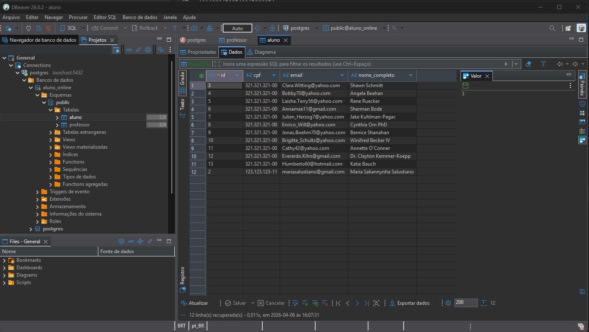
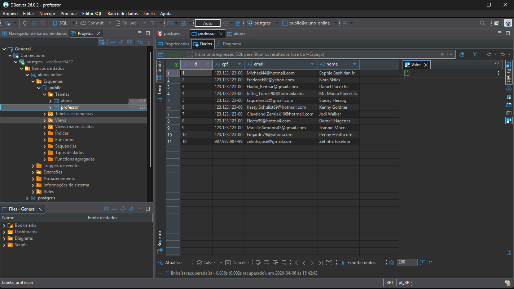
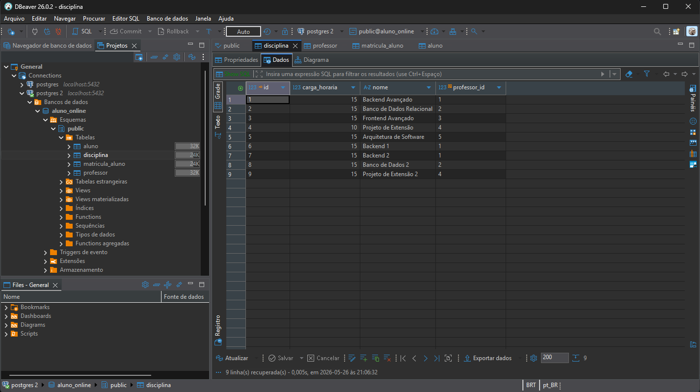
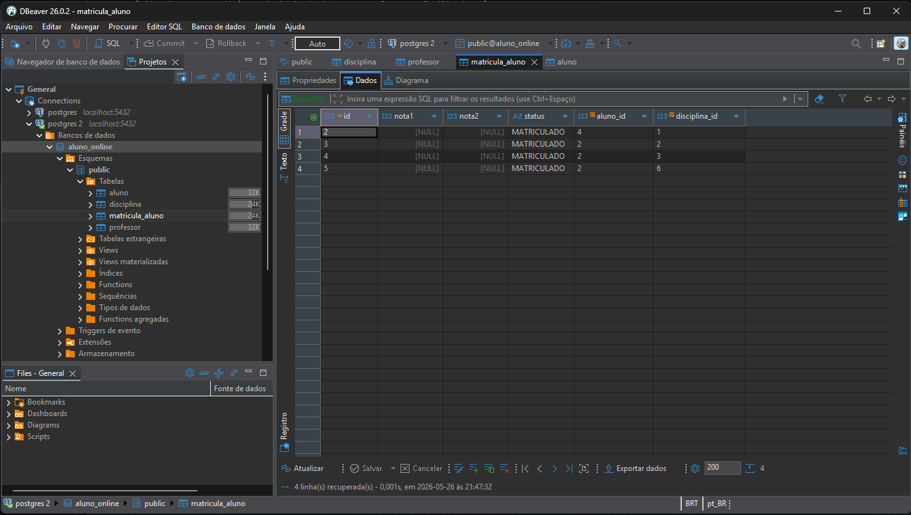
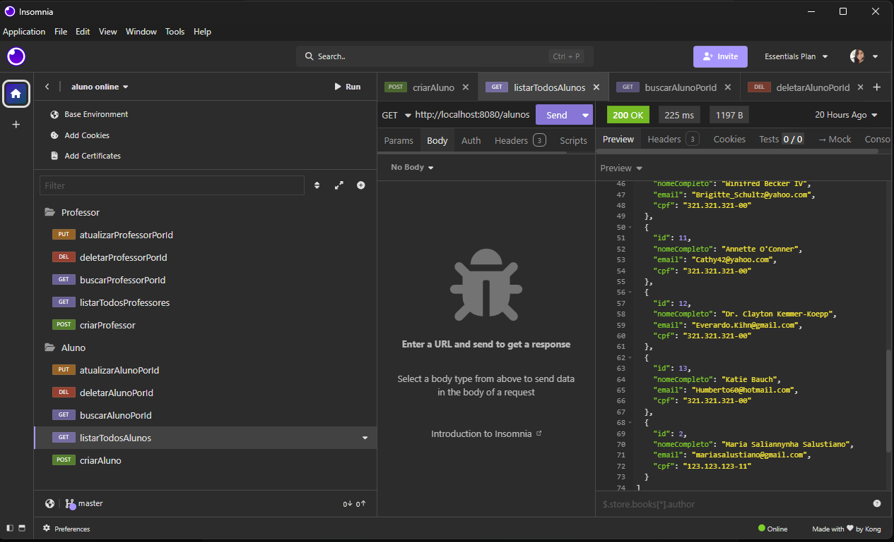
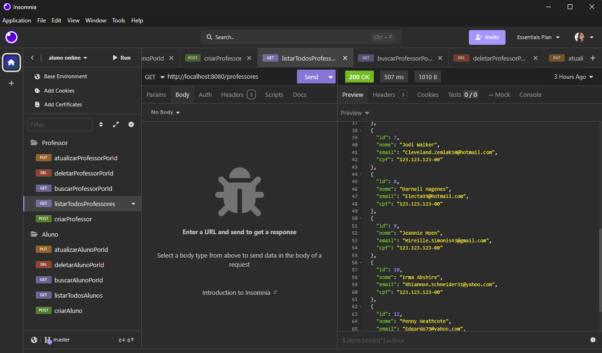
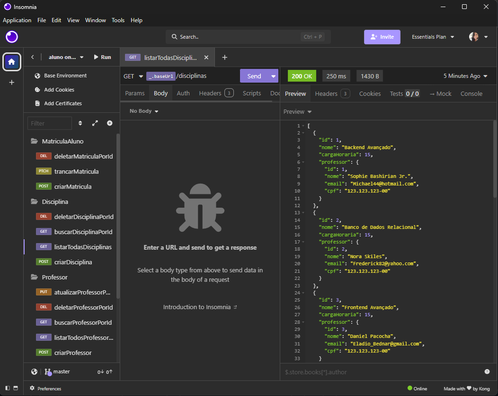
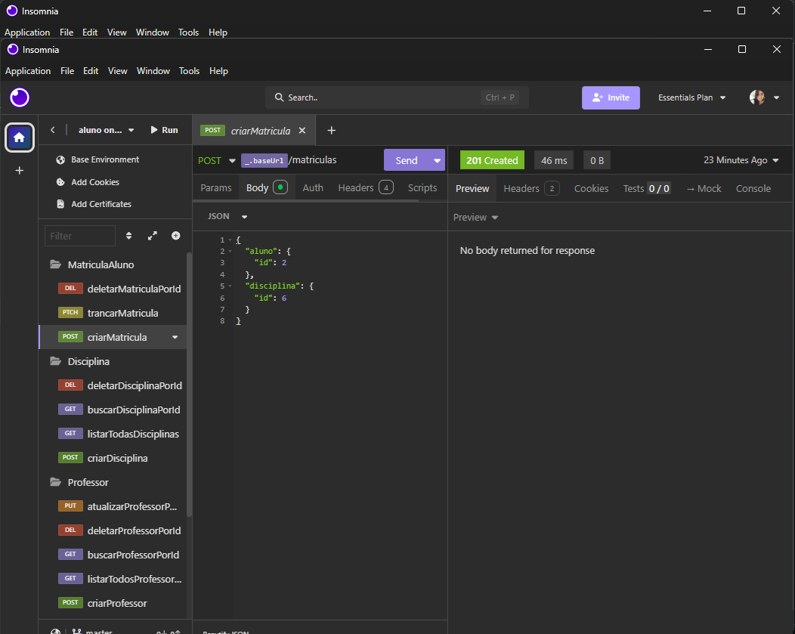

# 🎓 Projeto Aluno Online - API REST


Este projeto é uma API REST desenvolvida para fins acadêmicos. O sistema consiste em um CRUD (Create, Read, Update, Delete) completo para o gerenciamento de alunos, professores, disciplinas e matrículas, protegido por autenticação **Stateless com Spring Security e JWT**, documentado interativamente com **Swagger (OpenAPI)**. O projeto combina boas práticas de arquitetura Back-End (DTOs, validações e tratamento global de exceções) com a robustez da persistência de dados no PostgreSQL, utilizando Views para relatórios otimizados, Triggers para validações em tempo real e Stored Procedures para automação de regras de negócio complexas.


> Status: Em desenvolvimento ⚠️

---

## 🛠️ Funcionalidades

### 🔐 Segurança e Autenticação (Spring Security + JWT)
- **Cadastro de Usuários (`POST /cadastros`):** Criação de contas com validação de duplicidade de login e criptografia de senhas utilizando **BCrypt**.
- **Autenticação (`POST /login`):** Validação de credenciais e emissão de **Token JWT** assinado com algoritmo `HMAC256` e expiração configurada (2 horas).
- **Proteção de Rotas (`Stateless`):** Interceptação de requisições via `SecurityFilter`, bloqueando automaticamente o acesso sem token válido a todos os endpoints de negócio (`/alunos`, `/professores`, `/disciplinas` e `/matriculas`).
- **Padronização e Tratamento de Erros:** Uso de **DTOs (`Records`)** com Bean Validation (`@Valid`, `@NotBlank`) para entrada/saída de dados de Usuários, Alunos e Professores, aliado a um `TratadorDeErros` global (`@RestControllerAdvice`) para respostas padronizadas (`400 Bad Request` e `404 Not Found`).

### Gestão de Professores
- Cadastro de docentes com validação de campos obrigatórios (Nome, Email, CPF).
- Listagem de todos os professores cadastrados via DTO de detalhamento.
- Busca detalhada por ID.
- Atualização de dados e remoção.

### Gestão de Alunos
- Cadastro de alunos com validação de campos obrigatórios (Nome Completo, Email, CPF).
- Listagem completa de discentes via DTO de detalhamento.
- Busca por ID.
- Atualização e exclusão de registros.

### Gestão de Disciplinas
- Cadastro de disciplinas com associação ao respectivo Docente.
- Listagem geral e busca por ID de disciplinas cadastradas.
- Atualização e exclusão de disciplinas.

### Processos Acadêmicos (Matrícula e Notas)
- **Matrícula de Alunos:** Criação de vínculo entre um Aluno e uma Disciplina com o status inicial automático de `MATRICULADO`.
- **Trancamento:** Endpoint dedicado para trancar matrículas ativas.
- **Lançamento de Notas parciais:** Suporte a atualização de notas (`nota1` e `nota2`) de forma independente (PATCH parcial).
- **Cálculo Automatizado de Status:** O sistema processa a média aritmética do aluno ao receber as duas notas e altera o status acadêmico automaticamente para `APROVADO` (caso média >= 7.0) ou `REPROVADO`.
- **Regras de Exclusão Seguras:** Implementação de rota de deleção com tratativas de integridade referencial no banco de dados.
---

## 💻 Tecnologias Utilizadas

A estrutura deste projeto foi planejada para oferecer uma base sólida, escalável e de fácil manutenção. Utilizou-se o ecossistema Spring Boot para gerenciar a complexidade do Back-End, garantindo que as regras de negócio de Alunos, Professores, Disciplinas, Matrículas e Autenticação sejam processadas de forma eficiente.

Abaixo, estão as principais ferramentas e bibliotecas que compõem o stack tecnológico da aplicação:

| Tecnologia | Finalidade |
| :--- | :--- |
| ☕ **Java 21** | Linguagem principal com recursos modernos. |
| 🍃 **Spring Boot** | Framework base da aplicação (Use a versão mais recente). |
| 🔐 **Spring Security** | Controle de acesso, autenticação Stateless e criptografia BCrypt. |
| 🎟️ **Auth0 Java-JWT (4.5.0)** | Geração, assinatura e validação de tokens JWT. |
| ✅ **Spring Boot Validation** | Validação declarativa de dados nos DTOs (`@Valid`, `@NotBlank`). |
| 📄 **SpringDoc OpenAPI (Swagger UI)** | Documentação interativa e testes dos endpoints com suporte a Bearer Token. |
| 🐘 **PostgreSQL** | Banco de dados relacional. |
| 📦 **Maven** | Gestão de bibliotecas e build do projeto. |
| **Spring Web** | Criação de endpoints REST e tratamento HTTP. |
| **Spring Data JPA** | Persistência de dados e consultas SQL facilitadas. |
| **Lombok** | Redução de código boilerplate (Getters/Setters). |

---

## 📄 Documentação Interativa (Swagger UI)

Com a aplicação em execução, a documentação interativa da API pode ser acessada pelo navegador em:

```text
http://localhost:8080/swagger-ui/index.html
```
### Como autenticar no Swagger:
1. Utilize o endpoint público **`POST /cadastros`** para criar um usuário (ou utilize um já cadastrado).
2. Execute o endpoint público **`POST /login`** com o `login` e `senha` para receber o Token JWT.
3. Clique no botão **Authorize** no topo da página do Swagger, cole o token gerado (sem aspas) e confirme.
4. Todas as rotas protegidas (identificadas com o ícone de cadeado 🔒) estarão liberadas para teste.

---

## 🗄️ Estrutura do Banco de Dados

O projeto utiliza o **PostgreSQL** para armazenar as informações. Abaixo, a visualização das tabelas `aluno` e `professor` no DBeaver:

### Tabela: Aluno

*Campos: id, nome_completo, email, cpf.*

### Tabela: Professor

*Campos: id, nome, email, cpf.*

### Tabela: Disciplinas

*Campos: id, carga_horaria, nome, professor_id.*

### Tabela: Matrículas

*Campos: id, nota1, nota2, status, aluno_id, disciplina_id.*

---

## 🟣 Testes da API (Insomnia)

A seguir, estão os resultados dos testes realizados nos endpoints da aplicação:

### Listagem de Alunos


### Listagem de Professores


### Listagem de Disciplinas


### Criação de Matrículas


---

## ⚙️ Como Executar o Projeto

1. **Clone o repositório (via terminal):**
   ```bash
   git clone https://github.com/flaviarhuana/Projeto-Aluno-Online.git

2. **Configuração do Banco de Dados e Chave JWT:**

   No arquivo <kbd>src/main/resources/application.properties</kbd>, ajuste as credenciais do banco e a chave secreta do JWT de acordo com seu ambiente local:

   ```properties
   spring.datasource.url=jdbc:postgresql://localhost:5432/aluno_online
   spring.datasource.username=seu_usuario
   spring.datasource.password=sua_senha
   api.security.token.secret=${JWT_SECRET:12345678}
   ```
3. **Execute a aplicação:**
   Pelo IntelliJ, execute a classe <kbd>ApiApplication.java</kbd> ou via terminal (dentro da pasta `api`):

   ```bash
   mvn spring-boot:run
   ```
---

## 🛠️ Configuração do Banco de Dados

Este projeto utiliza recursos nativos do PostgreSQL (Views, Triggers e Stored Procedures) para regras de negócio acadêmicas.

Os scripts para criação e atualização das estruturas estão localizados em:
`src/main/resources/db/scripts/`

- `views.sql`: Relatórios e espelhos de notas.
- `triggers.sql`: Regra de limite de matrículas e logs de auditoria.
- `procedures.sql`: Rotina automática de arredondamento de médias.

**Nota:** Execute os scripts no seu cliente SQL (ex: DBeaver) antes de rodar a aplicação para o pleno funcionamento das regras de validação.
